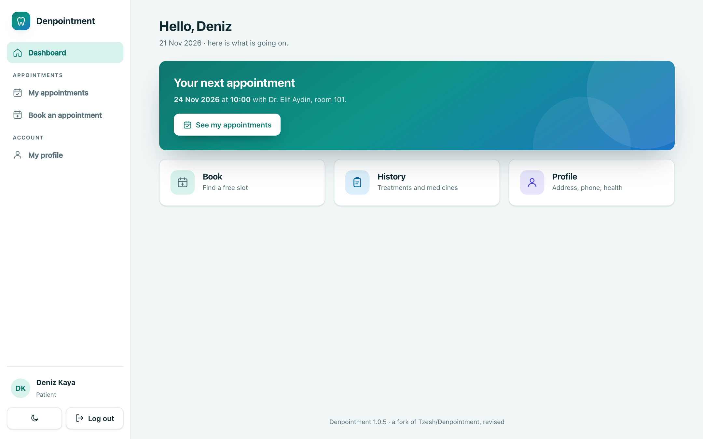
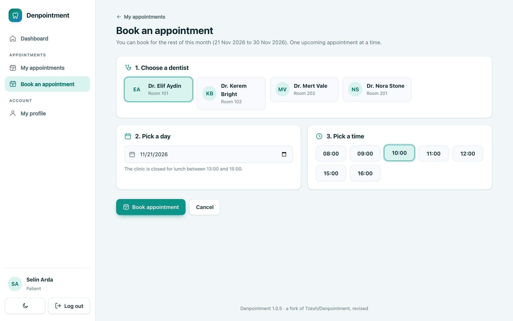
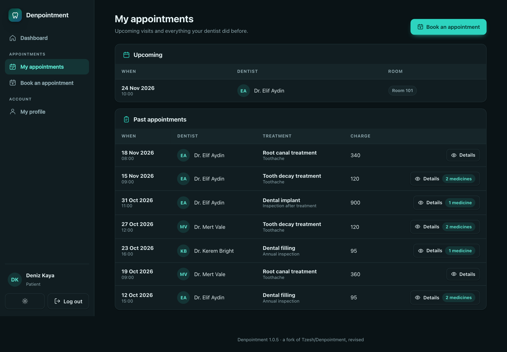
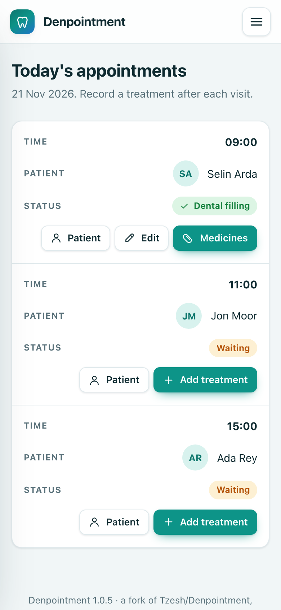

# Denpointment

> Denpointment is a joint project with [Uğur Dindar (Tzesh)](https://github.com/Tzesh/Denpointment), who wrote the original application. This repository carries it on after the fork and revises it: new structure, new interface, tests and a user guide (see [What changed](#what-changed)). The original repository has no licence file.

A dentist appointment system written in Python with Flask. Patients register, add their contact data and book appointments; dentists see their day, record treatments and medicines, plan holidays and read statistics.



| Booking | Dark theme | Phone |
| --- | --- | --- |
|  |  |  |

The illustrated **[user guide (PDF)](Docs/User-Guide.pdf)** walks through every page.

## Features

**Patients**
- register, then activate the account by adding an address and a phone number,
- keep addresses, phone numbers and chronic diseases, change email and password,
- book one appointment at a time for the rest of the current month,
- see upcoming and past appointments, with treatment, charge and medicines.

**Dentists**
- today's appointments with the treatment form, medicines per treatment,
- upcoming appointments and the profiles of the patients who booked,
- treatment history with a search by date,
- holidays (next month only, three days at most) that block booking,
- statistics: busiest dentists, common complaints, average and highest charges.

## Quick start (demo, no MySQL needed)

You need Python 3.9 or newer.

```
python3 -m venv .venv
.venv/bin/pip install -r requirements.txt
.venv/bin/python main.py --demo
```

Open http://127.0.0.1:5000. The demo uses a throw-away SQLite file in `Data/` that is created again on every start, with dates relative to today. All demo accounts use the password `demo1234`:

| Email | Shows |
| --- | --- |
| `patient@denpointment.example` | a patient with an upcoming appointment and a history |
| `patient2@denpointment.example` | a patient who can book right now |
| `fresh@denpointment.example` | a new account that still has to add an address and a phone number |
| `dentist@denpointment.example` | a dentist with appointments today, upcoming ones and holidays |

## Running with MySQL

1. Create a database named `dentist_management_system` and import [Backend/Database/dentist_management_system.sql](Backend/Database/dentist_management_system.sql). It comes with sample data; the accounts `demoperson@gmail.com`, `demopatient@gmail.com` and `demodentist@gmail.com` have the password `tzesh`.
2. Install the packages (see above) and set the connection. Everything is optional, the defaults are shown:

   | Variable | Default |
   | --- | --- |
   | `DENPOINTMENT_DB_HOST` | `localhost` |
   | `DENPOINTMENT_DB_PORT` | `3306` |
   | `DENPOINTMENT_DB_USER` | `root` |
   | `DENPOINTMENT_DB_PASSWORD` | empty |
   | `DENPOINTMENT_DB_NAME` | `dentist_management_system` |
   | `DENPOINTMENT_SECRET_KEY` | random at every start, so everybody is logged out after a restart; set a long random string in production |

3. Start it with `.venv/bin/python main.py`. Options: `--host`, `--port`, `--debug`.

`main.py` uses Flask's development server. Put a real WSGI server (for example gunicorn with `Backend.app:create_app()`) in front of it for production.

## Project layout

```
main.py                 Starts the app (--demo for the SQLite demo)
version.py              Version, raised by a git hook on every commit
requirements.txt
Backend/
  app.py                Application factory
  config.py             Settings from environment variables
  database.py           MySQL (PyMySQL) and SQLite behind one small class
  forms.py              Flask-WTF forms (input shape, CSRF)
  security.py           Login and role decorators
  clock.py              The current time, replaceable in tests
  repositories/         All SQL, one class per part of the data
  services/             The rules of the clinic (booking, holidays, treatments, ...)
  routes/               Blueprints: auth, account, patient, dentist
  Database/             MySQL dump with sample data, SQLite schema
Frontend/
  templates/            Jinja templates
  static/               CSS (light and dark theme), JS, icons
Tests/                  pytest suite
Scripts/                Demo data, screenshots, guide build, version bump
Docs/                   User guide (HTML source, PDF) and its images
```

Requests go routes → services → repositories → database. Services raise a `RuleViolation` with a message when a rule is broken and the route shows it; routes never contain SQL and repositories never contain rules.

## Tests

```
.venv/bin/python -m pytest
```

The suite (about 80 tests) runs against SQLite with a fixed clock: login and registration, profile rules, booking rules, holidays, treatments and medicines, role guards, CSRF, statistics and that every page opens.

## What changed

- **Structure:** the single `denpointment.py` is split into an application factory, blueprints, services and repositories; settings and the secret key come from environment variables.
- **Interface:** rebuilt without the bundled Bootstrap: own CSS with a light and a dark theme, responsive layout (tables become cards on phones), animations, inline icons, confirm dialogs, toasts. No external CDN or font is loaded.
- **Security:** CSRF tokens on every form, delete actions are POST requests instead of links, the same message for a wrong email and a wrong password, a new session after login, only local addresses are accepted as the page to return to, security headers and a content security policy, a dentist only sees patients who booked with them.
- **Fixes:** the digit checks of the forms were not anchored, so letters next to digits were accepted; appointment times are compared as one number instead of month by month; the statistics SQL now also runs with MySQL's default `ONLY_FULL_GROUP_BY`.
- **Extras:** a demo mode, tests, the illustrated user guide and `version.py`.

Not tested: the MySQL path has **not** been run against a real MySQL server. The SQL is plain ANSI and was checked against the column names of the dump, and the whole application runs against SQLite in the tests, but a first run on MySQL is the first real test of that path. Browsers: the interface was checked with Chromium only.

## Versioning

`version.py` holds the version. A git hook raises it on every commit (`0.0.9` becomes `0.1.0`, `0.9.9` becomes `1.0.0`). Enable it once after cloning:

```
git config core.hooksPath .githooks
```

## Rebuilding the screenshots and the guide

```
.venv/bin/python main.py --demo --port 5057
PLAYWRIGHT_PATH=/path/to/node_modules/playwright node Scripts/screenshots.mjs http://127.0.0.1:5057 Docs/Images
BROWSER="/path/to/a/chromium/based/browser" sh Scripts/build_guide.sh
```
